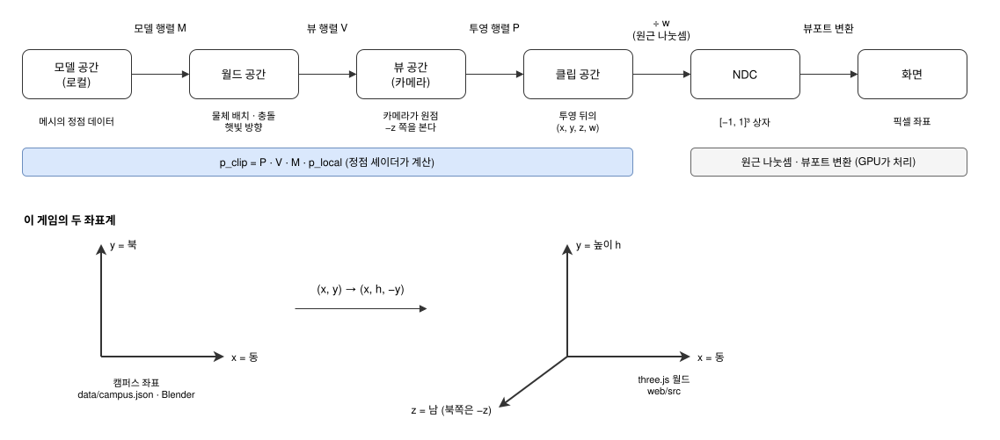
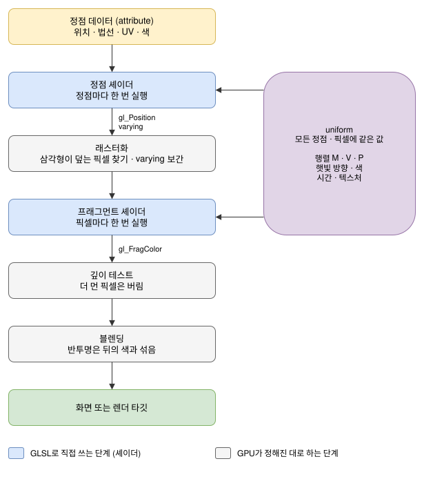
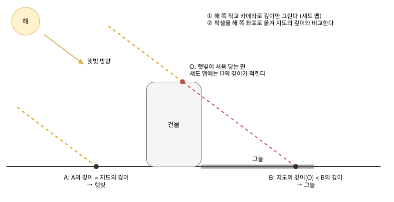
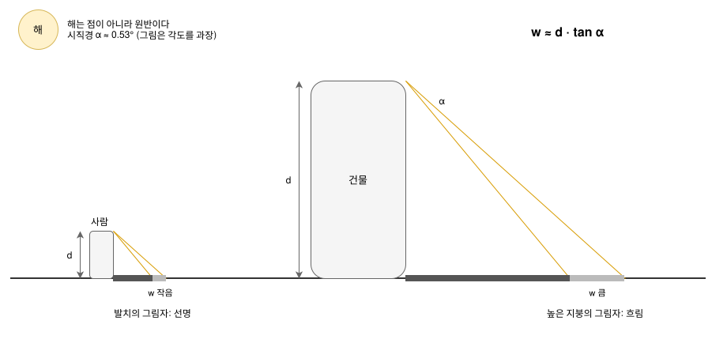
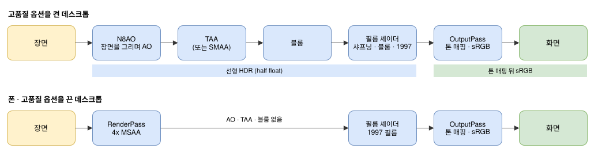

# 3D 그래픽 개념 안내

이 게임(`web/src/`)과 에셋 파이프라인(`blender/`, `tools/`)을 고치거나 기능을 더할 때 알아 두면 좋은 3D 그래픽 개념을 모았다.
1부는 어느 엔진을 쓰든 같은 **일반 개념**(공간과 수학, 빛, 재질, 그림자, 색, 후처리 …)이고, 2부는 이 게임이 실제로 쓰는
**라이브러리**의 짧은 소개와 공식 문서 주소다. 각 개념 끝의 「이 게임에서」에는 그 개념을 코드의 어디에서 쓰는지 적었다.

- 용어는 처음 나올 때 괄호 안에 영어 이름을 함께 적었고, 약어는 처음 나올 때 풀어 썼다.
- 수식은 GitHub가 그려 주는 `$…$` 표기로 쓴다. 벡터는 굵게 쓰지 않고 $v$ 로, 내적은 $a \cdot b$ 로, 정규화한 벡터는 $\hat{n}$ 으로 적는다.
- 그림은 draw.io로 그렸다(`docs/diagrams/*.drawio.svg`). 이 파일은 draw.io에서 바로 열어 고칠 수 있다.

---

## 1부. 엔진과 무관한 개념

### 1. 좌표계와 변환

**좌표계(coordinate system, frame)**. 한 점의 위치는 어느 원점(origin) · 어느 축(axis)을 기준으로 재느냐에 따라 숫자가 달라진다.
메시(mesh: 삼각형으로 이룬 3D 모델)의 정점(vertex: 삼각형의 꼭짓점)은 보통 아래 네 공간을 차례로 거친다.

| 공간 | 기준 | 쓰는 곳 |
|---|---|---|
| 모델(model, local) | 그 물체 자신의 원점 | 메시의 정점 데이터 |
| 월드(world) | 장면 전체의 원점 | 물체 배치, 충돌, 햇빛 방향 |
| 뷰(view, camera) | 카메라가 원점, $-z$ 가 보는 방향 | 조명 계산의 상당 부분 |
| 클립(clip) → NDC | 투영 뒤, $[-1, 1]^3$ 상자 | 래스터화(rasterization), 깊이 버퍼(depth buffer) |

NDC(normalized device coordinates, 정규화 장치 좌표)는 화면에 보이는 범위를 $x, y, z$ 모두 $-1$ ~ $1$ 로 맞춘 좌표다. 마지막에 화면의 픽셀 좌표로 늘린다.



**오른손 좌표계(right-handed coordinate system)**. three.js를 비롯한 대부분의 3D 라이브러리는 $x$ 오른쪽, $y$ 위, $z$ 화면 밖(보는 사람 쪽)인 오른손 좌표계를 쓴다.
지도 · GIS(geographic information system, 지리 정보 시스템) 자료는 보통 $x$ 가 동, $y$ 가 북이고 높이가 $z$ 다. 두 관습을 오갈 때 변환은 반드시 한 곳에서 한 번만 한다.

**이 게임에서**: 「캠퍼스 좌표」는 $x$ = 동, $y$ = 북이다(미터, `data/campus.json`, Blender 스크립트 전부). three.js 월드로 옮길 때는
$(x, y) \mapsto (x,\ h,\ -y)$ 로 바꾸므로 북쪽이 $-z$ 가 된다(`web/src/terrain.js` 머리 주석, `web/src/util.js` `placeMatrix`).
셰이더(shader: GPU에서 실행되는 작은 프로그램, 4장) 안에 자주 보이는 `vec2(vWPos.x, -vWPos.z)` 꼴은 이 변환을 되돌려 캠퍼스 좌표를 얻는 코드다
(`terrain.js`, `materials.js`, `grass.js`, `litter.js`).

#### 벡터 연산

- 내적(dot product) $a \cdot b = |a||b|\cos\theta$. 단위 벡터끼리의 내적은 곧 $\cos\theta$ 다. 「이 면이 빛을 얼마나 정면으로 받나」($\hat{n}\cdot\hat{l}$),
  「시선이 햇빛 방향과 얼마나 가까운가」(안개 색의 태양 쪽 가중치) 같은 질문에 답할 때 쓴다.
- 외적(cross product) $a \times b$ 는 두 벡터에 수직인 벡터다. 세 정점으로 삼각형의 법선(normal: 면에 수직인 단위 벡터, 3장)을 구할 때,
  카메라의 오른쪽 · 위 축을 만들 때 쓴다.
- 정규화(normalization) $\hat{v} = v/|v|$ 는 길이를 1로 맞춰 방향만 남긴다. 길이가 0인 벡터를 정규화하면 NaN(not a number, 숫자가 아닌 값)이 나오고,
  이 값이 계산을 따라 퍼지면 화면이 검게 칠해진다. 흔한 사고 원인이다.
- 선형 보간(linear interpolation, lerp) $\mathrm{lerp}(a, b, t) = a + (b - a)t$ 는 카메라 따라가기, 색 섞기, 높이 지도 보간 등 어디에나 쓰인다.
  `smoothstep(e_0, e_1, x)` 는 $[e_0, e_1]$ 구간을 $[0,1]$ 로 옮기고 $3t^2 - 2t^3$ 으로 부드럽게 만든다. 셰이더에서 경계를 흐릴 때 가장 먼저 쓰는 함수다.

#### 행렬과 동차 좌표

3D의 이동 · 회전 · 크기 변환을 곱셈 한 가지로 다루기 위해 점을 네 성분 $(x, y, z, 1)$ 로 늘리고 $4 \times 4$ 행렬을 곱한다(**동차 좌표, homogeneous coordinates**).
방향 벡터는 $w = 0$ 으로 두어 이동의 영향을 받지 않게 한다.

$$M = T \cdot R \cdot S$$

곱하는 순서에 따라 뜻이 달라진다. 위 식은 「먼저 크기를 바꾸고(scale), 회전하고(rotate), 마지막에 옮긴다(translate)」이다(점에 가장 가까운 행렬이 먼저 적용된다).
한 물체의 월드 행렬은 부모의 행렬과 자기 행렬의 곱 $M_{world} = M_{parent} \cdot M_{local}$ 이다. 정점은
$p_{clip} = P \cdot V \cdot M_{world} \cdot p_{local}$ 로 화면까지 간다($V$ 는 카메라 월드 행렬의 역행렬인 뷰 행렬, $P$ 는 투영 행렬).

**법선 행렬(normal matrix)**. 법선을 위치와 같은 행렬로 변환하면, 축마다 배율이 다른 크기 변환에서 면과 수직이 아니게 된다.
그래서 법선에는 $(M^{-1})^T$(역행렬의 전치 행렬)의 왼쪽 위 $3\times 3$ 을 쓴다. 크기 변환이 균등하면 회전 부분만 써도 된다.

**이 게임에서**: `placeMatrix(out, x, h, y, rot, scale)` 가 $T \cdot R_y \cdot S$ 를 한 번에 만든다. GLB를 합칠 때는 각 메시의
`matrixWorld` 를 지오메트리에 직접 적용해 정점 좌표를 월드 좌표로 바꿔 둔다(`world.js` `mergeStatic`, `InstancedKit`). 셰이더에서는 three.js가 주는
`modelMatrix`, `viewMatrix`, `projectionMatrix`, `normalMatrix` 를 쓴다. 뷰 공간 위치에서 월드 위치를 되찾을 때는
`(mvPosition.xyz - viewMatrix[3].xyz) * mat3(viewMatrix)` 처럼, 직교 행렬의 역행렬이 전치 행렬이라는 성질을 이용한다(`materials.js` `atmosEdit`).

#### 회전: 오일러 각과 사원수

오일러 각(Euler angles: yaw · pitch · roll)은 읽기 쉽지만, 두 회전축이 겹쳐 자유도 하나를 잃는 **짐벌 락(gimbal lock)** 이 있고 두 자세 사이를 보간하면 경로가 고르지 않다.
**사원수(quaternion)** $q = (x, y, z, w)$ 는 길이가 1인 네 성분으로 회전을 나타낸다. 회전의 합성은 사원수의 곱셈이고,
두 회전 사이는 `slerp`(spherical linear interpolation, 구면 선형 보간)로 고르게 보간할 수 있다.
「벡터 $a$ 를 벡터 $b$ 로 돌리는 최소 회전」은 `setFromUnitVectors(a, b)` 로 바로 얻는다.

**이 게임에서**: 걷는 사람의 방향은 yaw 하나다(`player.js`). 뼈를 목표 쪽으로 돌리는 IK(13장)는 사원수 곱으로 계산한다(`armpose.js` `aim`: 부모의 월드 회전을 곱해
월드 회전으로 바꾸고, 돌린 뒤 부모 회전의 역을 곱해 로컬 회전으로 되돌린다).

### 2. 카메라와 투영

**원근 투영(perspective projection)** 은 멀수록 작게 그린다. 세로 시야각(FOV, field of view), 종횡비(aspect ratio), 그릴 거리의 범위 **near · far**(가장 가까운 · 가장 먼 거리)가 투영을 정한다.
**직교 투영(orthographic projection)** 은 거리와 무관하게 같은 크기로 그린다. 햇빛의 그림자 지도(섀도 맵, 8장)처럼 태양이 무한히 먼 경우, 평면도,
임포스터(impostor, 12장) 굽기에 쓴다.

**깊이 정밀도**. 깊이 버퍼는 정밀도를 near 근처에 몰아준다. 그래서 near를 너무 작게 잡으면 먼 곳에서 두 면의 깊이가 같아져,
두 면이 번갈아 보이며 떨리는 **z-fighting**(깊이 다툼)이 난다. far/near 비는 가능한 한 작게 잡는다.
하늘처럼 「항상 가장 멀리」 있어야 할 것은 $z = w$ 로 두어 far 평면에 붙인다.

**절두체(frustum)와 컬링(culling)**. 절두체는 카메라가 보는 꼭대기 잘린 피라미드 모양 공간이다. 물체의 경계 구(bounding sphere)가 절두체 밖이면 그리지 않는다(frustum culling).
경계 구가 실제 물체보다 작으면 화면 가장자리에서 물체가 사라져 보인다.

**이 게임에서**: 걷기 카메라는 FOV 66°, near 0.1, far 12000이다(12 km 원경까지 그린다, `main.js`). 하늘 돔은
`gl_Position.z = gl_Position.w` 와 `renderOrder = 10` 으로 맨 뒤에 두고 마지막에 그려, 다른 물체에 가려진 픽셀은 셰이딩하지 않는다(`terrain.js` `makeSky`).
움직이는 사람은 쉬는 자세의 경계 구를 1.35배 키워 팔 · 다리가 잘리지 않게 한다(`characters.js`).
그림자 카메라는 한 변 250 m의 직교 카메라다.

### 3. 메시와 지오메트리

메시의 데이터는 **정점** 목록과, 정점 세 개씩을 골라 삼각형을 만드는 **인덱스(index)** 목록이다. 정점마다 **속성(attribute)** 이 붙는다: 위치, 법선, UV, 색, 그리고
필요하면 임의의 숫자.

- **법선(normal)**: 면에 수직인 단위 벡터. 조명의 $\hat{n}\cdot\hat{l}$ 에 쓴다. 정점 법선을 이웃 면의 평균으로 두면 둥글게(smooth), 면마다 따로 두면 각지게(flat) 보인다.
- **UV**: 정점이 텍스처(texture: 표면에 입히는 이미지)의 어느 자리를 쓰는지 나타내는 $[0,1]^2$ 좌표. 이름은 $x, y, z$ 와 헷갈리지 않게 붙인 두 축 이름 $u, v$ 에서 왔다.
  1을 넘으면 반복하거나(`RepeatWrapping`) 가장자리 색으로 고정한다. glTF(3D 모델 파일 형식, 2부)는 $v = 0$ 이 이미지 위쪽이다.
- **정점 색과 임의 속성**: 색뿐 아니라 어떤 숫자든 정점에 실어 셰이더로 보낼 수 있다. 조명 계산을 미리 해 두거나(베이크, bake: 오래 걸리는 계산을 미리 해 결과를 저장)
  재질 값을 정점마다 달리 줄 때 쓴다.
- **인덱스 공유**: 같은 자리의 정점을 여러 삼각형이 공유하면 메모리가 줄고 법선이 부드러워진다. 각진 모서리는 정점을 둘로 나눠야 한다.

**높이 지도(heightfield)** 는 격자 위의 높이 배열이다. 격자 사이 임의 점의 높이는 네 모서리의 **쌍선형 보간(bilinear interpolation)** 으로 얻는다.

$$h(x, y) = (1-a)(1-b)\,h_{00} + a(1-b)\,h_{10} + (1-a)b\,h_{01} + ab\,h_{11}$$

실제로 그리는 메시는 격자 칸마다 삼각형 둘로 쪼개므로 쌍선형 면과 수십 cm 어긋날 수 있다(`blender/common.py` `ground_top` 주석).

**이 게임에서**: 근경 지형은 5 m 격자, 원경 지형은 100 m 격자다(`terrain.js` `Heightfield`, `gridGeometry`). 지형 가장자리에는 틈을 가리는 「스커트(skirt)」를 내린다.
Blender가 쓴 GLB(glTF의 이진 파일)의 `COLOR_0` 은 색이 아니라 베이크 데이터고(`bake` 속성), 사람 메시의 `rough` 속성은 부위별 거칠기다.
풀 한 포기의 `aBlade` 는 (톤, 발치 0 → 끝 1)이다(`grass.js`).

### 4. 래스터화 파이프라인과 셰이더

#### 셰이더

**셰이더(shader)** 는 GPU(graphics processing unit, 그래픽 처리 장치)에서 실행되는 작은 프로그램이다. 이름은 「음영(shade)을 계산하는 프로그램」에서 왔지만,
지금은 정점의 자리를 옮기는 일부터 화면 전체를 다시 칠하는 후처리까지 GPU에서 도는 프로그램을 모두 셰이더라고 부른다.
GPU는 같은 셰이더를 수천 개의 정점이나 픽셀에 동시에 실행한다. 그래서 셰이더 하나는 정점 하나나 픽셀 하나만 보고 계산하며, 다른 픽셀의 계산 결과를 읽을 수 없다.
블러처럼 이웃 픽셀이 필요한 효과는 한 번 그린 결과를 텍스처로 받아 다음 패스(pass: 화면 전체를 한 번 그리는 단계)에서 읽는다.

실시간 렌더링(real-time rendering)에서 쓰는 셰이더는 두 가지다.

- **정점 셰이더(vertex shader)**: 정점마다 한 번 실행된다. 정점을 클립 공간으로 옮기고(1장), 프래그먼트 셰이더로 넘길 값을 계산한다.
- **프래그먼트 셰이더(fragment shader)**: 삼각형이 덮는 픽셀마다 한 번 실행되어 그 픽셀의 색을 계산한다. 조명 · 텍스처 · 안개가 모두 여기서 계산된다.
  프래그먼트(fragment)는 「아직 화면에 쓰이지 않은 픽셀 후보」라는 뜻이고, DirectX에서는 픽셀 셰이더(pixel shader)라고 부른다.

셰이더가 받는 값은 세 종류다.

| 종류 | 뜻 | 예 |
|---|---|---|
| attribute | 정점마다 다른 값. 메시에 들어 있다 | 위치, 법선, UV |
| uniform | 한 번 그리는 동안 모든 정점 · 픽셀에 같은 값. CPU(central processing unit) 쪽 자바스크립트가 넣어 준다 | 행렬, 햇빛 방향, 시간, 텍스처 |
| varying | 정점 셰이더가 쓰고, 래스터화 단계가 삼각형 안에서 보간한 뒤 프래그먼트 셰이더가 읽는 값 | 월드 위치, 법선 |

WebGL의 셰이더 언어는 **GLSL(OpenGL Shading Language)** 이다. C와 비슷한 문법에 `vec3`, `mat4` 같은 벡터 · 행렬 타입이 들어 있다.
아래는 three.js의 `ShaderMaterial` 로 쓴 가장 작은 셰이더 한 쌍이다. 정점 셰이더는 정점을 클립 공간으로 옮기면서 법선을 넘기고,
프래그먼트 셰이더는 그 법선으로 람베르트 조명(5장)을 계산한다. `position`, `normal`, `modelViewMatrix`, `projectionMatrix`, `normalMatrix` 는 three.js가 자동으로 넣어 주는 값이다.

```glsl
// 정점 셰이더: 정점마다 한 번
varying vec3 vNormal;                          // 프래그먼트 셰이더로 넘길 값
void main() {
  vNormal = normalMatrix * normal;             // 법선을 뷰 공간으로
  gl_Position = projectionMatrix * modelViewMatrix * vec4(position, 1.0);   // 클립 공간 위치
}
```

```glsl
// 프래그먼트 셰이더: 픽셀마다 한 번
uniform vec3 uColor;                           // 재질 색
uniform vec3 uLightDir;                        // 뷰 공간의 햇빛 방향(정규화)
varying vec3 vNormal;                          // 삼각형 안에서 보간된 법선
void main() {
  float lambert = max(dot(normalize(vNormal), uLightDir), 0.0);
  gl_FragColor = vec4(uColor * lambert, 1.0);
}
```

#### 래스터화 파이프라인

GPU가 한 프레임을 그리는 순서다. 파란 칸이 셰이더로 직접 쓰는 단계, 회색 칸이 GPU가 정해진 대로 하는 단계다.



1. **정점 셰이더**: 정점을 클립 공간으로 옮기고, 픽셀 단계로 넘길 값(varying)을 계산한다.
2. **래스터화(rasterization)**: 삼각형이 덮는 픽셀을 찾고, varying을 삼각형 안에서 보간한다.
3. **프래그먼트 셰이더**: 픽셀 색을 계산한다.
4. **깊이 테스트(depth test)**: 이미 그린 것보다 멀면 버린다. 그래서 불투명한 것은 어느 순서로 그려도 결과가 같다.
5. **블렌딩(blending)**: 반투명한 것은 뒤의 색과 섞는다. 순서에 따라 결과가 달라지므로, 보통 불투명한 것을 다 그린 뒤 먼 것부터 가까운 것 순으로 그린다.

**알파 테스트(alpha test)와 알파 블렌딩(alpha blending)**. 나뭇잎처럼 픽셀마다 「있다/없다」만 있는 투명은 알파 테스트(`alphaTest`)로 픽셀을 버리는 편이 낫다.
정렬이 필요 없고, 깊이를 쓰고, 그림자도 진다. 유리 · 물 · 연기처럼 정말 반투명한 것만 블렌딩한다.

**렌더 타깃(render target, 오프스크린)**. 화면 대신 텍스처에 그리는 것. 그림자 지도, 후처리, 임포스터 굽기, 파도 시뮬레이션은 모두 렌더 타깃에 그린 뒤 그 결과를 다른 셰이더가 읽는다.
8비트 텍스처는 0 ~ 1 사이 값만 담으므로 HDR(7장) 값은 **half float**(16비트 부동소수) 타깃에 둔다.

**드로 콜(draw call)**. 「이 지오메트리를 이 재질로 그려라」라는 CPU → GPU 명령 하나. 드로 콜이 많으면 GPU에 여유가 있어도 CPU가 명령을 보내는 데 프레임 시간을 다 써 버린다.
줄이는 방법은 두 가지다. 같은 재질의 정적 메시를 **합치기(merge)** 와, 같은 메시를 행렬만 바꿔 여러 번 그리는 **인스턴싱(instancing)** 이다.

**이 게임에서**: 셰이더를 쓰는 방법은 두 가지다.

- 하늘 돔(`terrain.js`), 블롭 그림자(`blobs.js`), 후처리 패스(`post.js`), 분수 수면(`water/fountain.js`), 먼 나무 임포스터(`impostors.js`) 등은
  셰이더를 처음부터 직접 쓴 `ShaderMaterial` 이다.
- 건물 · 나무 · 땅처럼 three.js 내장 재질을 쓰는 것은 `onBeforeCompile` 로 내장 셰이더의 일부를 바꾼다(2부 three.js).

드로 콜은 이렇게 줄인다. 건물 200여 동은 (재질, 160 m 청크)마다 한 메시로 합치고(`world.js` `mergeStatic`), 나무 · 소품 · 차는
`InstancedMesh`(`InstancedKit`)로 그린다. 풀은 카메라 주위만 다시 채우는 `InstancedMesh` 하나(`grass.js`), 사람은 부위를 전부 합친 `SkinnedMesh` 하나다
(`characters.js`). 폰의 블롭 그림자는 깊이를 쓰지 않는 곱셈 블렌딩이다(`blobs.js`).

### 5. 빛: 방사 측정의 기초와 광원의 종류

표면이 밝게 보이는 정도는 그 면에 떨어지는 빛의 양(**조도, irradiance**)과 표면이 그중 얼마를 되돌리는지(**알베도, albedo**)의 곱이다.

**람베르트의 코사인 법칙(Lambert's cosine law)**. 평행광이 면에 비스듬히 들면 같은 빛이 넓은 면적에 퍼지므로 조도는 $\cos\theta$ 에 비례해 줄어든다.

$$E = E_0 \max(0,\ \hat{n}\cdot\hat{l})$$

이것이 모든 조명 계산의 출발점이다. 거친(확산, diffuse) 표면은 어디서 봐도 같은 밝기 $L = \frac{\rho}{\pi} E$ 로 보인다($\rho$ 는 알베도).

**광원의 종류**

| 종류 | 성질 | 이 게임 |
|---|---|---|
| 평행광(directional) | 방향만 있고 위치는 없다. 태양 | 햇빛 `DirectionalLight` 하나. 방향은 HDRI의 가장 밝은 픽셀에서 역산(`blender/sky_bake.py`, `data/sky.json`) |
| 반구광(hemisphere) | 위쪽 색과 아래쪽 색을 법선 방향에 따라 섞는다 | 햇빛 받은 땅이 벽에 되쏘는 빛(아래쪽 색)과 희미한 하늘(위쪽 색) |
| 환경광(environment, IBL) | 360° 이미지(HDRI)의 각 방향을 빛으로 쓴다 | Poly Haven 하늘 HDRI에서 태양 원반을 지운 것 |
| 주변광(ambient) | 모든 면에 같은 상수 | 쓰지 않음(반구광 · 환경광이 대신) |
| 점광(point) · 스폿(spot) | 위치가 있고, 거리의 제곱에 반비례해 약해진다 | 쓰지 않음(창의 불빛은 발광 텍스처로 흉내) |

IBL은 image-based lighting(이미지 기반 조명), HDRI는 high dynamic range image(밝기를 실제 값의 범위대로 담은 사진)의 약자다.

**직접광(direct light)과 간접광(indirect light)**. 광원에서 바로 온 빛이 직접광, 다른 면에 한 번 이상 튀어 온 빛이 간접광이다.
실시간 렌더링은 간접광을 환경광 · 반구광 · 베이크 · AO(앰비언트 오클루전, 8장)로 **근사**한다.
그래서 「그늘이 너무 어둡다」 같은 문제는 보통 광원이 아니라 이 근사들을 조절해 푼다.

**환경광의 사전 적분(PMREM)**. PMREM(prefiltered mipmapped radiance environment map)은 환경 이미지를 거칠기 단계별로 미리 흐려 둔 밉맵(6장) 사슬이다.
거친 면은 흐린 단계를, 매끈한 면은 선명한 단계를 읽어 적은 계산으로 반사를 얻는다.

**이 게임에서**: 환경 이미지에 태양 원반이 남아 있으면, 그림자 지도로 막을 수 없는 「환경광 속의 태양」이 그늘을 비춘다. 그래서 원반을 지운 HDRI로 환경광을 만들고,
원반이 주던 빛의 양(`sun_E`)을 재서 `DirectionalLight` 의 세기에 더한다(`main.js` 머리의 긴 주석). 풀의 조명은 장면의 빛을 실제로 재서(흰 평면을 렌더 타깃에 그리고 읽어 옴)
정점마다 적용한다(`grass.js` `calibrate`).

### 6. 재질: PBR과 텍스처

**물리 기반 렌더링(PBR, physically based rendering)** 은 재질을 측정할 수 있는 값 몇 개로 적어, 어떤 조명에서도 그럴듯하게 보이게 하는 관습이다.
가장 널리 쓰이는 **metal/roughness 워크플로(workflow)** 의 값은 다음과 같다.

| 값 | 뜻 |
|---|---|
| base color(albedo) | 확산 반사색. 금속이면 반사색. 조명 · 그림자가 들어 있지 않은 「순수한 색」이어야 한다 |
| roughness 0 ~ 1 | 미세한 표면의 거칠기. 0은 거울, 1은 완전 무광 |
| metalness 0 ~ 1 | 금속이면 확산 반사가 없고 반사가 색을 띤다 |
| normal map | 정점을 늘리지 않고 픽셀마다 법선을 기울여 요철을 흉내 |
| emissive | 스스로 내는 빛 |
| AO map | 미리 계산한 가림(간접광만 줄인다) |

**미세면 BRDF**. BRDF(bidirectional reflectance distribution function, 양방향 반사율 분포 함수)는 빛이 들어온 방향과 보는 방향에 따라 표면이 빛을 얼마나 되돌리는지 나타내는 함수다.
미세면(microfacet) 모델은 표면을 방향이 제각각인 아주 작은 거울들의 모임으로 본다. 표준은 GGX 분포(미세면 방향의 분포 모델, Trowbridge-Reitz 분포라고도 한다) $D$,
기하 감쇠 $G$, 프레넬 $F$ 의 곱이다.

$$f_{spec} = \frac{D(\hat{h})\,G(\hat{l},\hat{v})\,F(\hat{v},\hat{h})}{4\,(\hat{n}\cdot\hat{l})(\hat{n}\cdot\hat{v})}, \qquad \hat{h} = \frac{\hat{l}+\hat{v}}{|\hat{l}+\hat{v}|}$$

**프레넬 효과(Fresnel effect)**. 비스듬히 볼수록 모든 표면이 더 많이 반사한다. 슐릭 근사(Schlick's approximation)는 $F = F_0 + (1 - F_0)(1 - \hat{v}\cdot\hat{h})^5$ 이고,
비금속의 $F_0$ 은 대개 0.04(4 %)다. 물 · 유리의 가장자리에 하늘이 비치는 이유다.

**에너지 보존(energy conservation)**. 반사로 나간 빛은 확산에서 빼야 한다. 어느 재질도 받은 것보다 밝게 되쏘지 않는다.

**텍스처의 종류와 색 공간**. 색을 담은 텍스처(base color)는 **sRGB** 로 저장되어 있어 읽을 때 선형으로 풀어야 하고, 데이터를 담은 텍스처(normal, roughness, 마스크, 높이)는
그대로(**linear**) 읽어야 한다. 둘을 뒤바꾸면 색이 바래거나 요철이 과장된다(7장).

**밉맵(mipmap)과 필터링**. 멀리 있는 텍스처는 미리 반씩 줄여 둔 사슬(밉맵)에서 알맞은 단계를 읽어 반짝임(aliasing, 10장)을 막는다.
비스듬히 보는 바닥은 **비등방성 필터링(anisotropic filtering)** 으로 흐림을 줄인다.
`texture2D(t, uv, bias)` 의 세 번째 인자는 밉 단계를 강제로 올려 일부러 흐리게 읽는 값이다.

**타일링(tiling)과 아틀라스(atlas)**. 반복 텍스처는 UV를 미터 단위로 두고 `repeat = 1/tile` 로 조절하면 어떤 메시에서나 실제 크기가 맞는다.
작은 그림 여럿(나뭇잎 종류)은 한 장(아틀라스)에 모아 재질 수를 줄인다.

**스플랫 맵(splat map)**. 저해상도 지도 한 장의 R · G · B 채널을 가중치로 삼아 여러 타일 텍스처를 섞어, 넓은 땅을 칠하는 기법이다. 경계는 노이즈로 흐린다.

**이 게임에서**: 재질 정의는 `blender/materials.json`(= `web/public/data/materials.json`) 한 곳에 이름 · 텍스처 · `tile`(미터/반복) · `tint` · `rough` 로 적는다.
Blender는 미리 보기용으로, 웹은 `MeshStandardMaterial` 로 이 정의에서 재질을 다시 만든다(`materials.js` `MaterialLibrary`). GLB는 재질 **이름**만 들고 온다(`world.js` `bindMaterials`).
지형은 아스팔트 · 보도블록 · 흙 · 잔디를 스플랫 맵으로 섞고, 법선 맵도 같은 가중치로 섞는다(`terrain.js` `makeNearTerrain`). 베이크한 건물 재질은 정점 속성에서
AO(R), 처마 아래 비 자국(G · B), 햇빛(A)을 읽는다(`blender/bake.py` 머리 주석, `materials.js` `bakeShade`).

### 7. 색 공간, HDR, 톤 매핑

**선형(linear)과 sRGB**. 빛의 계산(더하기 · 곱하기)은 물리량에 비례하는 **선형** 공간에서 해야 맞다. 모니터와 이미지 파일은 사람 눈에 맞춘
**sRGB**(standard RGB, 대략 감마 2.2)로 값을 담는다. 그래서 입력 색 텍스처는 선형으로 풀어 계산하고, 마지막에 다시 sRGB로 인코딩해 화면에 낸다.
중간 결과를 8비트로 저장하면 어두운 쪽의 단계가 뭉개지므로 반 정밀도 부동소수를 쓴다.

**HDR과 노출**. HDR(high dynamic range)은 밝기의 범위가 넓다는 뜻이다. 햇빛 받은 흰 벽은 그늘보다 수백 배 밝다.
계산은 그 범위 그대로 하고, 화면의 0 ~ 1로 눌러 넣는 단계가 **톤 매핑(tone mapping)** 이다. 노출(exposure)은 톤 매핑 전에 곱하는 배율이다.

**톤 매핑 곡선**. 단순히 자르면(clamp) 밝은 곳이 하얗게 날아간다. Reinhard $x/(1+x)$, ACES(Academy Color Encoding System, 영화계의 색 관리 표준),
**AgX**(Blender 4.0부터 기본 톤 매핑) 같은 곡선은 밝은 쪽을 부드럽게 눌러 필름과 비슷한 계조를 낸다.
대신 「햇빛 받은 흰 벽」이 밋밋한 회색이 되기 쉬워, 블룸(10장)으로 그 반짝임을 되살리기도 한다.

**휘도(luminance)**. 색의 밝기를 나타내는 숫자 하나. 선형 공간에서는 $Y = 0.2126R + 0.7152G + 0.0722B$(Rec. 709, HDTV 색 표준)이고,
sRGB로 인코딩된 값에는 관습적으로 $0.299, 0.587, 0.114$ 를 쓴다. 코드에 두 계수가 다 보이는 이유다.

**이 게임에서**: `renderer.toneMapping = AgXToneMapping`, 노출 1.05다(`main.js`). 후처리 체인은 전부 선형 HDR(half float)에서 돌고, 마지막의 `OutputPass` 가 톤 매핑과 sRGB 인코딩을 한다(`post.js`).
HDRI 하늘은 Blender에서 ACES와 비슷한 곡선으로 눌러 JPG로 만들고 배경에만 쓴다(`blender/sky_bake.py`).
SMAA(10장)는 선형 값에서 가장자리를 찾지 못하므로, $\sqrt{c/(1+c)}$ 로 임시 인코딩한 값에서 찾는다(`post.js` `hdrSMAA`).

### 8. 그림자

실시간 그림자의 표준은 **섀도 맵(shadow map)** 이다.

1. 광원 자리에 카메라를 두고(평행광이면 직교 카메라) 장면의 **깊이**만 텍스처에 그린다.
2. 본 카메라로 그릴 때 각 픽셀을 광원 카메라의 좌표로 옮겨 그 깊이와 비교한다. 지도에 적힌 깊이가 더 가까우면 그 사이를 무언가 가린 것이므로 그늘이다.



**흔한 문제**

- **섀도 아크네(shadow acne)**: 지도의 해상도 한계로 면이 제 그림자를 줄무늬로 받는다. 깊이를 조금 미는 **bias**, 법선 방향으로 미는 **normal bias** 로 막는다.
- **피터 패닝(peter panning)**: bias가 크면 그림자가 발에서 떨어진다. 피터 팬의 그림자가 몸에서 떨어져 나가는 데서 온 이름이다.
- **해상도**: 지도가 덮는 범위가 넓을수록 한 텍셀(texel: 텍스처의 픽셀)이 땅의 더 넓은 자리를 차지해 계단이 보인다.
  그래서 카메라 주위에만 지도를 두고 따라 움직이며, 텍셀 단위로 **스냅(snap)** 해 떨림을 막는다.
  범위를 거리별로 여러 장 두는 것이 캐스케이드(cascade) 섀도 맵(CSM, cascaded shadow maps)이다.

**부드러운 가장자리**. PCF(percentage-closer filtering)는 이웃 텍셀 여럿과 깊이를 비교해, 가려진 비율을 그림자 농도로 쓴다.
**PCSS(percentage-closer soft shadows)** 는 여기에 더해, 가리개와 받는 면 사이의 거리에 따라 번짐(**반그림자, penumbra**)의 폭을 바꾼다.
태양의 시직경(angular diameter) $\alpha \approx 0.53°$ 에서 가리개와 받는 면의 거리가 $d$ 면, 반그림자 폭은 닮은 삼각형으로 다음과 같다.

$$w_{penumbra} \approx d \cdot \tan\alpha$$

그래서 발치의 그림자는 선명하고 높은 지붕의 그림자는 흐려져 사진과 비슷해진다. 대신 가리개 탐색 · 필터링에 텍셀을 많이 읽는다.



**베이크한 그림자**. 광원이 움직이지 않으면 그림자를 미리 계산해 텍스처나 정점에 담아 둘 수 있다. 실행 중 비용이 거의 없고 범위 제한도 없지만, 움직이는 물체는 담지 못한다.
**블롭 그림자(blob shadow)** 는 움직이는 것 발밑에 어두운 원을 그리는, 가장 싼 대안이다.

**앰비언트 오클루전(ambient occlusion, AO)**. 좁은 틈 · 구석은 하늘(간접광)이 덜 들어 어둡다. 오프라인에서는 반구로 광선을 쏘아 구워 두고(베이크),
실시간에서는 화면의 깊이 버퍼로 근사한다. 후자를 SSAO(screen-space ambient occlusion, 화면 공간 AO)라고 하고, GTAO(ground-truth ambient occlusion)는 더 정확하게 근사하는 SSAO 계열 기법이다.
AO는 간접광만 줄여야 하고 직접광을 줄이면 안 된다.

**이 게임에서**: 햇빛이 움직이지 않는다는 점을 여러 곳에서 이용한다.

- 실시간 섀도 맵은 4096², 한 변 250 m이고, PCF 소프트 그림자를 쓰거나 데스크톱 고품질(HQ) 옵션에서 PCSS를 쓴다(`materials.js` `pcss`, `updatePcss`).
- 정적인 것의 그림자는 지도 범위가 움직일 때만 다시 그려 캐시에 두고, 매 프레임에는 사람 · 차의 그림자만 덧그린다(`shadows.js` `SunShadows`).
- 캠퍼스 전체의 땅 그림자는 31 cm 텍셀 한 장으로 미리 구워 두고(`bakedshadow.js`, `tools/bake_sun_shadows.mjs`), 지도 밖과 폰에서 쓴다.
  정문 밖 동네 · 신촌 로터리는 같은 장의 옆 띠에 70 cm 텍셀로 넣는다(재질이 읽는 텍스처 수를 늘리지 않으려고).
  건물 벽 · 지붕은 Blender가 정점마다 햇빛 여부를 구워 둔다(`blender/bake.py` A 채널).
- 폰에는 섀도 맵을 켜면 그래픽 드라이버가 멈추는 기기가 있어 아예 끄고(`main.js`), 블롭 그림자(`blobs.js`)를 쓴다.
- 바람에 흔들린 잎은 쉬는 자리의 그림자를 읽어, 제 그림자 안팎을 오가며 깜빡이지 않게 한다(`materials.js` `restShadow`).
- 화면 공간 AO는 N8AO(2부), 베이크 AO는 `bake.py` R 채널이다.

### 9. 대기: 안개, 산란, 구름 그림자

**비어-람베르트 법칙(Beer–Lambert law)**. 빛이 흐린 매질을 거리 $s$ 만큼 지나면 $e^{-\sigma s}$ 만 남는다($\sigma$ 는 소광 계수, extinction coefficient).
나머지는 흩어져 「안개 색」이 되어 보인다.

$$C = C_{물체}\, e^{-\sigma s} + C_{안개}\,(1 - e^{-\sigma s})$$

이것이 지수 안개(`FogExp2`)다. 실제 대기는 낮은 곳일수록 짙으므로, 높이와 무관한 균일한 안개는 높은 곳에서 내려다볼 때 어색하다.
**높이 안개(height fog)** 는 $\sigma$ 가 높이에 따라 $\sigma_0 e^{-k y}$ 로 줄어든다고 보고 시선을 따라 적분한다.
카메라 높이 $y_c$ 에서 상대 벡터 $r$ 끝까지의 광학 두께(optical depth)는 다음과 같다.

$$\tau = \sigma_0\, e^{-k y_c}\, |r| \cdot \frac{1 - e^{-k\,r_y}}{k\,r_y}$$

$r_y \to 0$ 이면 마지막 항이 1로 수렴하므로, 코드는 $k\,r_y$ 가 작을 때를 따로 처리한다.

**안개의 색**. 실제 하늘의 지평선은 태양 쪽이 밝고 따뜻하며 반대쪽은 푸르스름하다. 시선과 태양 방향의 내적으로 두 색을 섞고,
태양 가까이에는 전방 산란(forward scattering: 빛이 원래 가던 방향 쪽으로 많이 흩어지는 성질)으로 생기는 빛무리를 더한다.

**구름 그림자**. 구름층 높이 $H$ 를 정하고, 지상의 점 $p$ 에서 태양 방향으로 올라가 구름층과 만나는 자리의 노이즈 값을 읽어 햇빛 세기에 곱한다.
가리개가 아니라 빛의 배율이므로 섀도 맵과 무관하고, 폰에서도 계산이 적다.

**이 게임에서**: 모두 `materials.js` 의 `ATMOS` · `ATMOS_GLSL` · `globalPatch` 에 있다. 장면의 모든 재질에 같은 셰이더 조각을 끼워 넣고,
하늘 돔도 같은 함수로 지평선을 칠해 땅과 하늘 사이에 이음새가 없다.

### 10. 안티앨리어싱과 후처리

**앨리어싱(aliasing)**. 픽셀은 네모라서 비스듬한 가장자리에 계단이 생기고, 픽셀보다 가는 물체는 프레임마다 보였다 안 보였다 하며 깜빡인다.
이것을 줄이는 기법이 안티앨리어싱(anti-aliasing)이다.

| 기법 | 원리 | 비용 · 단점 |
|---|---|---|
| MSAA(multisample anti-aliasing) | 가장자리 픽셀만 여러 표본으로 깊이 · 커버리지를 재서 평균 | 장면을 그릴 때만 가능. 후처리로 다시 그린 것엔 안 됨 |
| SMAA(subpixel morphological anti-aliasing) | 완성된 화면에서 가장자리 모양을 찾아 섞음 | 가장자리만. 깜빡임은 못 잡음 |
| TAA(temporal anti-aliasing) | 매 프레임 카메라를 서브픽셀만큼 **지터(jitter)** 하고 이전 프레임을 **재투영(reprojection)** 해 누적 | 흐려짐(샤프닝으로 보정), 움직이는 것의 유령(history clamp로 억제) |

**재투영**. 현재 픽셀의 깊이로 월드 위치를 복원하고, 이전 프레임의 뷰 · 투영 행렬로 그 점이 어디 있었는지 찾아 그 자리의 이전 색을 읽는다. 그래서 TAA에는 깊이 버퍼가 필요하다.
지터 패턴은 저불일치 수열(low-discrepancy sequence: 고르게 흩어지는 수열, Halton 수열 등)을 쓴다.

**블룸(bloom)**. 아주 밝은 곳만 뽑아(threshold) 흐린 뒤 더하면 렌즈의 빛 번짐(halation)이 된다. 보통 반 · 1/4 해상도로 내려가며 흐린다.
**Karis 평균**(밝은 픽셀일수록 가중치를 낮춤)은 픽셀 하나의 반짝임이 깜빡이는 빛 덩어리로 번지는 것을 막는다.

**필름 룩(film look)**. 채도 낮추기, 따뜻한 틴트(tint), 들린 블랙(lifted blacks), 비네팅(vignetting: 가장자리 어둡게 하기), 그레인(grain: 필름 입자).
전부 색을 바꾸는 간단한 수식이고, 톤 매핑 **앞**(선형)에서 할 것과 **뒤**에서 할 것을 구분해야 한다.

**가우시안 블러(Gaussian blur)의 분리성**. 2D 가우시안은 가로 1D와 세로 1D의 곱이므로 1D 패스 두 번으로 처리한다.
텍스처의 선형 보간으로 두 텍셀 사이를 한 번에 읽으면 탭(tap: 텍스처를 한 번 읽는 것) 수가 반으로 준다(9탭을 5번 읽기).

**이 게임에서**: 후처리 순서는 아래 그림과 같다(`post.js`). N8AO가 장면을 자기 타깃에 그려 MSAA를 쓸 수 없으므로 고품질 경로는 TAA를 쓴다.
폰과 고품질 옵션을 끈 데스크톱은 AO · TAA · 블룸 없이 `RenderPass` + 4x MSAA다.



### 11. 노이즈, 난수, 표본 패턴

- **해시 함수(hash function)**: 좌표를 넣어 겉보기에 무작위인 0 ~ 1 값을 얻는다(`hash12`). 셰이더에는 난수 생성기가 없어 이렇게 만든다. 그레인, 디더링, 경계 흐리기에 쓴다.
- **그래디언트 노이즈(gradient noise)와 fBm**: 격자점에 무작위 기울기를 두고 보간한 부드러운 노이즈(Perlin 노이즈 류). 주파수를 두 배씩 올리며 진폭을 줄여 더한 것이
  **fBm**(fractal Brownian motion, 프랙털 브라운 운동)이고, 구름 · 지형 · 얼룩의 기본 재료다. 주기를 격자 수에 맞추면 이어 붙여도 경계가 보이지 않는다(**타일링**).
- **시드(seed) 있는 난수**: 같은 시드에서 늘 같은 배치가 나와야 재현과 디버깅을 할 수 있다. `mulberry32` 가 그런 작은 생성기다.
- **보겔 원반(Vogel disc)**: $r_i = \sqrt{(i+0.5)/n}$, $\theta_i = i \cdot 2.39996$(황금각)으로 원 안에 고르게 흩어진 표본점. PCSS의 가리개 탐색 · 필터 탭, AO의 표본에 쓴다.
- **디더링(dithering)**: 부족한 비트 · 단계 수를 노이즈로 흩어 띠(banding)와 깜빡임을 가린다. 거리별로 하나씩 사라지는 풀 포기, 임포스터 교체에 쓴다.

**이 게임에서**: `materials.js` `cloudTexture`(두 채널 타일링 fBm), `vogel`, `util.js` `mulberry`, `terrain.js` `hash12`, `grass.js` `keep`.

### 12. LOD와 임포스터

멀리 있는 것은 세밀할 필요가 없다. 거리별로 다른 메시를 쓰는 것이 **LOD**(level of detail, 세부 단계)다.
나무처럼 수가 많고 복잡한 것은 아예, 실제 모델을 몇 방향에서 미리 그린 이미지를 판에 붙인 **임포스터(impostor, 빌보드 billboard라고도 한다)** 로 바꾼다.
가까이 오면 다시 진짜 메시로 돌아간다. 교체 거리에서 모양이 갑자기 바뀌는 것이 보이면 디더로 섞는다.

**이 게임에서**: 230 m 밖의 나무는 임포스터로 바뀐다(`world.js` `Forest`, `impostors.js`).

- 나무 모델마다 여덟 방위와 위에서 본 그림을 실행 중에 아틀라스로 구워 둔다. 아틀라스는 색과 법선 두 장이고, 계절이 바뀌면 다시 굽는다.
- 임포스터는 카메라를 향한 판 하나다. 보는 방향에 가까운 두 그림과 위에서 본 그림을 섞어 그린다.
- 법선 아틀라스가 있어 다른 재질처럼 장면의 해로 비춘다. 그래서 먼 나무도 해 쪽은 밝고 반대쪽은 어둡다.
- 교체 거리 안쪽 몇 m에서 디더로 서서히 바꾼다.
- 임포스터는 그림자를 드리우지 않으므로 그 자리의 땅 그림자는 베이크 지도가 맡는다.

### 13. 애니메이션: 스켈레톤, 스키닝, IK

**스켈레톤(skeleton)** 은 뼈(bone)의 트리다. 뼈마다 부모 뼈를 기준으로 한 변환이 있다. **스키닝(skinning)** 은 정점마다 「어느 뼈가 얼마나(가중치, weight: 보통 네 개까지)」
영향을 주는지 적어 두고, 정점 셰이더가 뼈 행렬의 가중 합으로 정점을 옮기는 기법이다.
**애니메이션 클립(animation clip)** 은 뼈들의 회전 · 위치를 시간에 따라 적은 키프레임(keyframe)이다. 두 클립을 **크로스페이드(crossfade)** 하면 걷기에서 뛰기로 부드럽게 넘어간다.
발이 미끄러지지 않으려면 클립 재생 속도를 실제 이동 속도에 맞춘다.

**IK(inverse kinematics, 역운동학)**. 「손이 이 점에 가도록」 뼈의 각도를 거꾸로 구한다. 뼈가 둘(위팔 · 아래팔)이면 코사인 법칙으로 닫힌 해(closed-form solution)를 구할 수 있다.
팔 길이가 $a, b$, 목표까지의 거리가 $c$ 면 팔꿈치 각 $\gamma$ 는 다음과 같다.

$$\cos\gamma = \frac{a^2 + b^2 - c^2}{2ab}$$

**이 게임에서**: Quaternius 모듈러 캐릭터를 `SkinnedMesh` 하나로 합치고, 사람마다 `AnimationMixer` 를 둔다(`characters.js`). 농구공을 들 때 두 손을 공에 붙이는 두 뼈 IK는 `armpose.js` 에, 그것으로 짠 슛 · 패스 동작은 `ballpose.js` 에 있다. 공의 길을 어깨 자리에서 정하고 손을 IK 로 보낸 뒤, 공을 손이 실제로 간 자리로 옮겨 팔이 덜 닿아도 공이 뜨지 않게 한다.

### 14. 충돌과 공간 질의

- **레이캐스트(raycast)**: 한 점에서 한 방향으로 직선(ray)을 쏘아 처음 만나는 삼각형을 찾는다. 발밑 땅 높이, 마우스 피킹(picking: 화면에서 누른 물체 찾기), 벽 감지의 기본이다.
- **BVH(bounding volume hierarchy, 경계 볼륨 계층)**: 가까운 삼각형끼리 경계 상자에 모으고, 그 상자들을 다시 더 큰 상자에 모은 트리.
  삼각형 수십만 개에 레이를 쏠 때 전부 검사하지 않고 $O(\log n)$ 으로 찾는다. 미리 만들어 두어야 한다.
- **균일 격자(uniform grid)**: 2D 평면을 칸으로 나누고, 칸마다 그 칸에 걸친 물체 목록을 둔다. 「내 주위 3×3 칸」만 보면 되므로 정적 콜라이더(collider: 충돌 판정용 도형)가 많을 때 좋다.
- **점이 다각형 안에 있는지 판정**: 그 점에서 한쪽으로 반직선을 쏘아 변과 교차한 횟수가 홀수면 안이다(짝수-홀수 규칙, even-odd rule).
- **원 밀어내기**: 캐릭터를 반지름 $r$ 의 원으로 보고, 겹친 물체의 가장 가까운 점에서 멀어지는 방향으로 거리가 $r$ 이 될 때까지 밀어낸다. 여러 번 반복하면 모서리에서도 안정된다.
- **포사체(projectile)**: $p(t) = p_0 + v_0 t + \tfrac{1}{2} g t^2$. 목표 지점이 정해져 있으면 비행 시간을 먼저 정하고 $v_0$ 를 역산하는 편이 쉽다.

**이 게임에서**: 지형 · 길 · 계단 메시에 BVH를 만들어(`three-mesh-bvh`, `player.js` 머리) 발밑과 벽을 레이로 찾는다.
건물 외곽선 · 나무 · 사람은 8 m 격자의 2D 콜라이더로 처리한다(`player.js` `Colliders`). 원이 걸친 칸만 읽고, 경계 상자가 원에 닿지 않는 것은 건너뛴다. 농구공 물리는 `hoops.js` 에 있다.

### 15. 물 표면(간단히)

- **FFT와 테센도르프 파도**: FFT(fast Fourier transform, 고속 푸리에 변환)는 신호를 주파수가 다른 사인파들의 합으로 나누거나,
  거꾸로 사인파들을 더해 신호로 되돌리는 계산(푸리에 변환)을 빠르게 하는 알고리즘이다. 제리 테센도르프(Jerry Tessendorf)의 바다 파도 기법은
  파장마다 파도가 얼마나 큰지를 나타내는 통계적 스펙트럼(spectrum: 바람의 세기 · 방향 · 바람이 분 거리로 정해짐)을 주파수 공간에서 만든다.
  매 프레임 파장마다 위상(phase)을 돌린 뒤 역 FFT로 사인파 수천 개를 한 번에 더해 높이 맵을 얻는다.
  **분산 관계(dispersion relation)** $\omega^2 = gk + \frac{\sigma}{\rho}k^3$ 가 파장별 속도를 정한다(둘째 항은 잔물결을 만드는 표면장력).
  크기가 다른 격자 여러 장(**캐스케이드**)을 겹쳐 큰 파도와 잔물결을 함께 담는다.
- **스넬의 법칙(Snell's law)과 굴절(refraction)**: $n_1 \sin\theta_1 = n_2 \sin\theta_2$. 수면에서 시선을 굴절시켜 바닥을 보면 바닥이 일렁인다.
- **코스틱(caustics)**: 굴절된 햇빛이 바닥에 모여 생기는 밝은 무늬. 수면 격자를 바닥으로 투영해, 면적이 줄어든 만큼 밝게 칠하는 **면적비 스플래팅**으로 근사한다.
- **프레넬 + GGX**: 수면은 거의 거울이라 6장의 반사 모델이 그대로 적용된다. 태양의 반짝임(glint)은 거칠기가 아주 작은 GGX 하이라이트다.

**이 게임에서**: 활천대 분수 수면(`web/src/water/fountain.js`)은 Ultra Water의 시뮬레이션과 코스틱을 64² 격자, 4.5 m ~ 19 cm 네 캐스케이드로 줄여 쓴다.

### 16. 성능의 감각

병목(bottleneck)은 보통 셋 가운데 하나다.

| 병목 | 증상 | 대책 |
|---|---|---|
| CPU(드로 콜 · 자바스크립트) | 단순한 장면인데 느림, 폰에서 더 느림 | 합치기, 인스턴싱, 매 프레임 할당 피하기(벡터 재사용), 갱신 주기 낮추기 |
| 정점 | 멀리서 봐도 느림 | LOD, 임포스터, 컬링 |
| 픽셀(fill rate: 초당 칠할 수 있는 픽셀 수) | 해상도 · 화면 크기에 비례해 느림, 후처리를 켜면 급락 | 반 해상도 패스, 오버드로(overdraw: 같은 픽셀을 여러 번 칠하기) 줄이기(하늘을 마지막에), 패스 수 줄이기 |

**GPU 메모리**는 거의 텍스처가 차지한다. 2K 텍스처 한 장이 밉맵을 포함해 약 22 MB이고, 폰에서는 텍스처 크기를 모두 반으로 줄인다(`materials.js` `MOBILE_MAX_TEX`).
8K 하늘 사진은 GPU에서 90 MB를 차지한다.

**셰이더 컴파일**은 시간이 오래 걸리고 재질 조합마다 일어난다. 같은 코드의 셰이더가 여러 번 컴파일되지 않게 캐시 키를 관리해야 한다(`materials.js` `patchShader` 의 `customProgramCacheKey`).

---

## 2부. 이 게임이 쓰는 라이브러리

버전은 `web/package.json` 과 `web/package-lock.json` 이 기준이다(2026-11 현재 three 0.170.0, n8ao 1.9.4, three-mesh-bvh 0.8.3).

### three.js (r170)

WebGL 위의 장면 그래프 · 재질 · 로더 · 후처리 라이브러리다. r170은 170번째 릴리스라는 뜻이다. 이 게임의 렌더링은 전부 three.js 위에서 돈다. 알아 둘 특징은 다음과 같다.

- 내장 재질(`MeshStandardMaterial` 등)의 셰이더는 `#include <chunk>` 조각으로 짜여 있고, `onBeforeCompile` 에서 조각을 문자열 치환해 고칠 수 있다.
  이 게임의 바람 · 베이크 · 안개 · PCSS · 지형 스플랫이 전부 이 방식이다. 조각 이름은 three.js 소스의 `src/renderers/shaders/ShaderChunk/` 에서 찾는다.
  **버전을 올리면 조각 내용이 바뀌어, 치환할 문자열을 찾지 못해도 오류 없이 치환만 빠질 수 있다.** 올린 뒤에는 꼭 화면을 확인한다.
- 애드온(`three/addons/…`): `GLTFLoader` · `DRACOLoader`(모델), `RGBELoader`(HDRI), `EffectComposer` · `RenderPass` · `ShaderPass` · `SMAAPass` · `OutputPass`(후처리), `BufferGeometryUtils.mergeGeometries`, `SkeletonUtils.clone`.
- 문서
  - 레퍼런스: https://threejs.org/docs/
  - 입문 매뉴얼: https://threejs.org/manual/
  - 예제: https://threejs.org/examples/
  - 버전별 변경(마이그레이션): https://github.com/mrdoob/three.js/wiki/Migration-Guide
  - 소스(셰이더 조각): https://github.com/mrdoob/three.js/tree/r170/src/renderers/shaders

### three-mesh-bvh

three.js 지오메트리에 BVH를 만들어 레이캐스트를 수백 배 빠르게 한다. `computeBoundsTree` 와 `acceleratedRaycast` 를 프로토타입에 끼워 넣어 쓴다(`player.js`).
문서(README): https://github.com/gkjohnson/three-mesh-bvh

### N8AO

three.js용 화면 공간 앰비언트 오클루전 패스다. `EffectComposer` 의 첫 패스로 장면을 그리면서 AO를 더한다(`post.js`). 투명 재질 감지를 끄는 이유는 그 파일의 주석에 있다.
문서(README): https://github.com/N8python/n8ao

### Ultra Water

three.js 바다 렌더러(MIT 라이선스)다. 그중 FFT 시뮬레이션(`OceanSim.js`)과 코스틱(`Caustics.js`)만 `web/src/water/ultra-water/` 에 들여와 분수 크기로 줄여 쓴다.
저장소: https://github.com/Humpalumps/Ultra-Water

### glTF 2.0과 Draco

glTF(GL Transmission Format)는 Blender에서 웹으로 모델을 옮기는 표준 형식이다(`.glb` 는 이진 묶음). 정점 데이터는 구글의 메시 압축 라이브러리 Draco로 압축되어 있어,
브라우저가 wasm(WebAssembly: 브라우저에서 도는 이진 코드 형식) 디코더(`web/public/draco/`)로 푼다.
Draco로 압축된 `COLOR_0` 은 16비트 정규화 정수로 돌아오므로 합칠 때 형식을 맞춘다(`world.js` `bakeU16`).
glTF 2.0 명세: https://registry.khronos.org/glTF/specs/2.0/glTF-2.0.html · Draco: https://google.github.io/draco/

### Blender와 bpy (에셋 파이프라인)

건물 · 랜드마크 · 나무 · 소품 · 길은 Blender를 백그라운드로 띄워 파이썬(`bpy`, `bmesh`)으로 생성하고 GLB로 내보낸다(`blender/build.py` 의 사용법 주석).
햇빛 · AO 베이크(`bake.py`)와 HDRI 처리(`sky_bake.py`)도 Blender에서 한다. 로컬 Blender는 5.2 LTS(long-term support, 장기 지원판)다.
Python API: https://docs.blender.org/api/current/ · 매뉴얼: https://docs.blender.org/manual/en/latest/ · glTF 내보내기: https://docs.blender.org/manual/en/latest/addons/import_export/scene_gltf2.html

### WebGL 2와 GLSL ES 3.00

WebGL(Web Graphics Library)은 브라우저에서 GPU로 그리는 표준 API이고, three.js가 그 위에서 돈다. 직접 쓴 셰이더(`ShaderMaterial`, 치환 조각)는 GLSL이다.
three.js는 GLSL ES 3.00으로 변환해 올리지만, 소스는 1.00 식(`texture2D`, `gl_FragColor`)으로 쓴다.
WebGL(MDN): https://developer.mozilla.org/en-US/docs/Web/API/WebGL_API · GLSL ES 3.00 명세: https://registry.khronos.org/OpenGL/specs/es/3.0/GLSL_ES_Specification_3.00.pdf

### 그 밖에

- **Vite**: 개발 서버와 번들러(`web/vite.config.js`). https://vite.dev/guide/
- **Playwright**: 헤드리스(화면 없는) Chromium으로 게임을 띄워 땅 그림자를 굽는다(`tools/bake_sun_shadows.mjs`). https://playwright.dev/docs/intro
- **Poly Haven**: CC0 PBR 텍스처와 HDRI의 출처(`tools/fetch_polyhaven.py`). https://polyhaven.com/
- **Quaternius**: CC0 캐릭터 모델과 애니메이션. https://quaternius.com/

---

## 추천하는 책과 자료

### 한국어

- 이득우, 『이득우의 게임 수학』(책만, 2022): 벡터 · 행렬 · 사원수 같은 3D 수학을, GPU 없이 CPU만으로 렌더러를 직접 만들며 익힌다. 이 문서의 1장(좌표 변환 · 사원수)과 13장(뼈의 계층 구조)을 깊이 이해하는 데 좋다.
- 한정현, 『OpenGL ES를 이용한 3차원 컴퓨터 그래픽스 입문』(홍릉과학출판사, 2019): 공간 변환, 정점 처리, 셰이더, 래스터화, 텍스처링을 이론과 실습으로 다루는 교과서다.
  영어판은 *Introduction to Computer Graphics with OpenGL ES*(CRC Press, 2018).
- Patricio Gonzalez Vivo · Jen Lowe, 『The Book of Shaders』 한국어판(온라인, 무료): 프래그먼트 셰이더 하나로 그림을 그리며 GLSL을 익힌다. 책의 노이즈 장이 이 문서의 11장과 이어진다.
  https://thebookofshaders.com/?lan=kr

### 영어

- Tomas Akenine-Möller 외, *Real-Time Rendering* 4판(CRC Press, 2018): 실시간 렌더링 전반의 표준 참고서. 이 문서 1부의 거의 모든 주제를 더 깊이 다룬다. https://www.realtimerendering.com/
- Steve Marschner · Peter Shirley, *Fundamentals of Computer Graphics* 5판(CRC Press, 2021): 대학 컴퓨터 그래픽스 과목의 대표 교과서.
- Fletcher Dunn · Ian Parberry, *3D Math Primer for Graphics and Game Development* 2판(2011, 온라인 무료): 좌표계 · 행렬 · 사원수를 그림과 함께 설명한다. https://gamemath.com/
- Matt Pharr · Wenzel Jakob · Greg Humphreys, *Physically Based Rendering* 4판(MIT Press, 2023, 온라인 무료): PBR 이론의 원전. https://pbr-book.org/
- Kouichi Matsuda · Rodger Lea, *WebGL Programming Guide*(Addison-Wesley, 2013): WebGL과 GLSL ES 셰이더를 예제 100여 개로 익힌다.

### 온라인 자료

- LearnOpenGL(무료): PBR · 섀도 맵 · HDR · 블룸 장이 이 문서 1부의 긴 판본이다. https://learnopengl.com/
- three.js 매뉴얼의 재질 · 조명 · 색 관리 안내: https://threejs.org/manual/#en/fundamentals (「Color Management」 항목)
