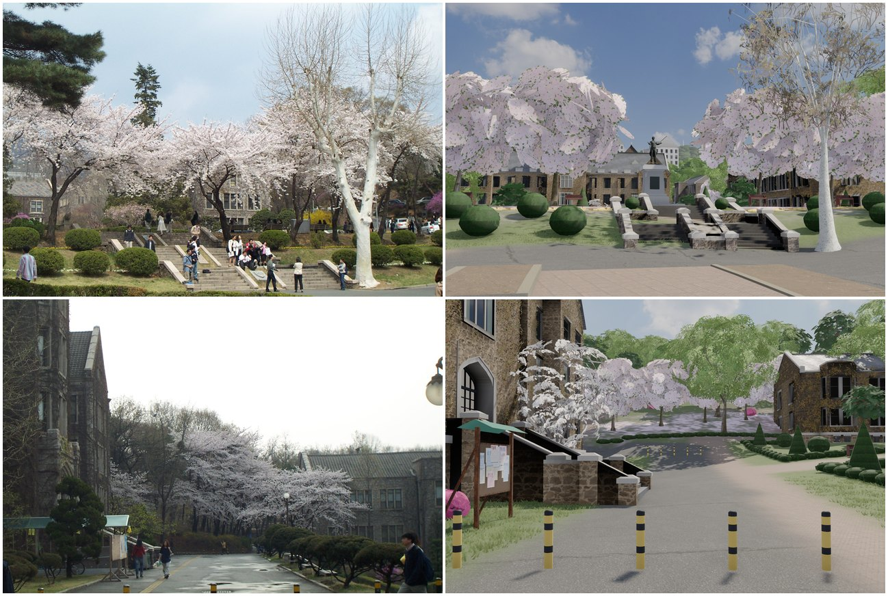
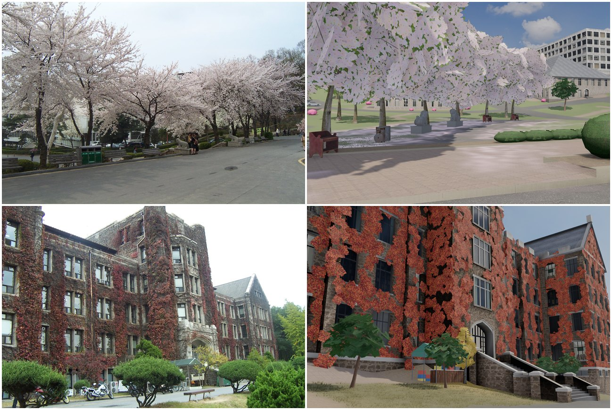

# 1997년 신촌 캠퍼스 산책 게임

1997년 봄과 가을(4월 벚꽃 · 5월 신록 · 10월 단풍 가운데 고름), 연세대학교 신촌 캠퍼스를 걸어 다니는 웹 3D 게임입니다.
정문에서 출발해 백양로를 따라 걸으면서 중앙도서관, 학생회관, 독수리상, 백주년기념관, 옛 노천극장,
언더우드관을 둘러볼 수 있습니다. 랜드마크 앞에서 **E** 를 누르면 `reference/` 폴더의 그 시절 사진과 이야기가 담긴
“추억 카드”가 열리고, 추억 스탬프가 하나씩 모입니다.


**바로 해 보기: http://yonsei-1997.benelog.net/** (GitHub Pages, `main`에 올리면 `.github/workflows/pages.yml`이 다시 배포)

건물 이름표는 걸을 때 가까운 건물 위에, 하늘에서 볼 때와 큰 지도에서는 건물마다 보입니다. 날짜별 업데이트 내역은 제목 화면의 「새 소식」(`web/public/data/releases.json`)에 있고, 화면 캡처가 들어간 별도 페이지 **http://yonsei-1997.benelog.net/news.html** (날짜마다 `#2026-11-06` 같은 주소로 바로 연결)로도 볼 수 있습니다.
새 소식을 쓸 때는 `releases.json` 맨 위에 `{date, groups: [{category, items, images: [{src, alt}]}]}` 를 더하고(날짜 아래 카테고리별로, `items` 는 문자열 또는 `{text, items: [...]}` 로 하위 목록을 중첩, 쓰는 규칙은 `CLAUDE.md`), 캡처는 `docs/screenshots/` 와 `web/public/assets/news/` 에 둡니다.

## 사진과 비교

1997년 무렵의 사진과 비슷한 자리에서 찍은 게임 화면입니다. 위(또는 왼쪽)가 사진, 아래(또는 오른쪽)가 게임입니다.
근거 자료는 [`고증.md`](reference/고증.md), 사진의 출처는 [`출처.txt`](reference/출처.txt)에 있습니다.

| | |
|---|---|
| <br>**백양로** · 1997년 항공 사진과 같은 카메라 | <br>**캠퍼스 서쪽** · 1995년 항공 사진 |
| <br>**중앙도서관** · 1997년 | <br>**학생회관** 외벽 · 2009년 |
| <br>**백주년기념관** 박물관 입구 · 1996년 | <br>**대강당** · 2009년 |
| <br>**언더우드관** · 2016년 | <br>**스팀슨관** · 2016년 |
| <br>**아펜젤러관** · 2016년 | <br>**연희관** · 2023년 가을 |
| <br>**대우관** (1996년 준공) | <br>**대우관 상뜰** |
| <br>**광복관** 현관 · 1996년 | <br>**과학관** 앞 계단 · 1996년 |
| <br>**음악관** 현관 · 1996년 | <br>**빌링슬리관** 현관 · 1996년 |
| <br>**용재관** (1957 – 2013, 지금 경영관 자리) | <br>**옛 노천극장** · 1997년 |
| <br>**활천대** · 2009년, 독수리상 옆의 옛 자리 | <br>**백양로 초소** · 1997년 |
| <br>**교육관** · 연희관 앞 정원 · 2003년 가을 | <br>**벚나무** · 백양로 끝 · 언더우드관 앞길 · 2003년 봄 |
| <br>**언더우드관 정원 남쪽 계단** · 앞길 볼라드 · 2003년 봄 | <br>**해태상** · 연희관 녹색 천막 매점 · 2003년 |

## 게임 화면

| | |
|---|---|
|  |  |
|  |  |
|  |  |

## 실행

```bash
cd web
npm install
npm run dev          # http://localhost:5197
npm run build        # web/dist 정적 사이트 (정적 호스팅 가능)
```

| 키 | 동작 |
|---|---|
| ↑ ↓ / W S | 앞뒤로 걷기 (Shift 뛰기) |
| ← → / A D | 방향 돌기 |
| 마우스 끌기 · 휠 | 카메라 돌리기 · 가까이/멀리 (걸으면 다시 등 뒤로) |
| E · Enter | 가까운 랜드마크의 추억 카드 보기 (화면의 안내 버튼을 눌러도 됩니다) |
| M | 캠퍼스 지도 (장소를 누르면 순간이동) |
| B | 캠퍼스 위로 날아가기(버드 아이뷰). 제목 화면의 「캠퍼스 위로 날아가기」로도 들어갑니다 |
| F | 1997 필름 감성 (색감 · 그레인 · 날짜 스탬프) |
| 1 · 2 · 3 | 계절: 4월 벚꽃 / 5월 신록 / 10월 단풍 |
| Esc | 일시정지 · 옵션 (그림자/AO 품질) |

조작과 카메라는 sim-office와 같은 방식입니다. 내 캐릭터를 3인칭으로 보며 걷고, 카메라가 등 뒤에서 따라옵니다.
제목 화면에서 1997년 학생 여섯 명 가운데 한 명과 출발할 곳(정문, 추억 장소, 이름 있는 건물의 현관 앞)을 고르고 「캠퍼스 산책하기」를 누릅니다.
모바일에서는 화면 왼쪽 아무 곳이나 누르면 그 자리에 가상 스틱이 생깁니다. 가고 싶은 쪽(화면 기준)으로 밀면 그쪽으로 걷고
(끝까지 밀면 뛰기), 화면 오른쪽을 끌면 카메라를 돌리고 두 손가락으로 벌리거나 오므려 가까이/멀리 봅니다.
추억 장소에서는 「눌러서 그때의 추억 보기」 버튼을, 오른쪽 위의 날아가기 · 지도 · 설정 버튼(미니맵을 눌러도 지도)을 씁니다.
PC 브라우저에서 모바일 화면을 시험하려면 주소 끝에 `?touch` 를 붙입니다.
캠퍼스 위로 날아가기는 sim-office의 「마을 둘러보기」처럼 캠퍼스 위를 자유롭게 날아다니는 카메라입니다. 높은 하늘에서부터 눈높이까지 내려갈 수 있습니다.

| 키 | 캠퍼스 위로 날아가기 |
|---|---|
| W S / ↑ ↓ · A D / ← → · Q E | 앞뒤로 날기 · 회전 · 옆으로 |
| Z X / 휠 · R F | 가까이·멀리 · 높이(내려다보는 각도) |
| Shift · Space | 빠르게 · 자동 회전 |
| T · Y · 1 2 3 | 계절 바꾸기 · 1997 필름 · 계절 고르기 |
| 마우스 끌기 · 오른쪽 끌기 · 더블클릭 | 둘러보기 · 밀어서 이동 · 그곳으로 날아가기 |
| 장소 핀 | 그곳으로 날아가 「여기서 걷기」(제목 화면에서 왔으면 바로 시작)·「추억 보기」 |
| Esc / B | 걷기(또는 처음 화면)로 돌아가기 |

아래 막대에는 계절·필름·자동 회전·「거리 높이」(눈높이로 내려가기)·「1997 사진 시점」·「전체 보기」·높이·확대 버튼이 있습니다. 모바일에서는 한 손가락으로 밀고, 두 손가락으로 확대·회전합니다.

## 무엇이 들어 있나

건물의 모양과 길의 위치의 근거는[`고증.md`](reference/고증.md)에 정리되어 있습니다.

- **실측 배치**: OpenStreetMap 건물 외곽선과 도로, 그리고 AWS Terrarium 고도 데이터로 만든 지형(안산 · 인왕산 · 북한산 원경 포함, 먼 산의 숲 덩어리와 안산 정상의 송신탑).
  1997년 이후에 지은 건물과 이웃 이화여대 건물은 빼고, 건물 이름 · 층수 · 재료 · 색은 1997년 무렵의 사진과 기록대로입니다(고증 3.1).
  지형의 5 m 고도 격자가 건물 앞을 비탈로 뭉개는 곳은 앞마당과 정원을 평평하게 다듬었습니다(`tools/build_campus.py` `FORECOURTS`).
  숲과 큰 건물 위에서 높게 나오는 고도 자료 탓에 한경길 북쪽 언덕(연희관 ~ 대우관)은 1997년 항공 사진에 맞춰 6 m 낮췄습니다(고증 3.5.1).
- **백양로**: 2015년 재창조 이전의 중앙분리대 없는 2차선 차도, 양쪽 회양목 띠와 보도, 은행나무 가로수와 생울타리입니다.
  1997년 항공 사진(`reference/1997_백양로_항공사진.jpg`)의 카메라를 역산해 길의 자리와 폭, 정문 안 갈림길과 화단섬, 현수막, 초소, 나무 높이를 사진에서 재어 옮겼고,
  높이는 재창조 설계 보고서의 종단면도대로 정문에서 본관 앞 삼거리까지 12 m 오릅니다(고증 2장, `tools/build_campus.py`, `blender/road.py`).
  캠퍼스 위로 날아가기의 「1997 사진 시점」 버튼은 그 카메라로 사진과 같은 장면을 보여 줍니다.
- **Blender로 직접 모델링한 랜드마크** (`blender/landmarks.py`, 건물마다의 근거는 고증 3장)
  - 중앙도서관: 높은 석재 기둥과 얕은 세그먼트 아치, 두 단 화강석 기단 위 아케이드, 유리문 너머 불 켜진 로비
  - 학생회관: 필로티, 흰 프리캐스트 콘크리트 판에 뾰족아치 창, 세로 현수막
  - 백주년기념관: 기단 위의 큰 원통과 무대 탑(북쪽에선 땅까지 내려와 발치에 곡면 유리 로비), 백양로 쪽의 어두운 현관과 남서쪽 앞 상자, 광혜원 쪽 박물관 입구
  - 언더우드관 · 스팀슨관 · 아펜젤러관 · 연희관: 갈색 잡석 벽, 계절마다 색이 바뀌는 담쟁이, 튜더 아치 안 철제 유리문 현관과 화강석 계단, 앞 정원.
    언더우드관 · 연희관은 탑 선 석조 고딕, 스팀슨관 · 아펜젤러관은 탑 없는 2층에 세 개씩 묶은 돌 문설주 창(스팀슨관은 가운데 현관부와 굴뚝, 아펜젤러관은 양끝의 꺾인 내닫이 칸)
  - 대우관 · 별관 (1996): 흰 석조 고딕, 석축 아래 아치 현관과 그 위 테라스, 상뜰, 뒤쪽 계단탑과 주차장
  - 대강당: 화강석 박공 정면, 양끝 탑, 열 단 위의 로비 현관
  - 제1공학관(1997년 크기), 광복관(모임지붕 ㄱ자와 화강석 현관), 용재관(1957 – 2013), 루스채플, 광혜원(팔작지붕 한옥), 옛 노천극장, 정문(延世大學校 현판)
  - 1990 · 1994 · 1995 지도에만 있는 옛 어학당 · 장기원 기념관 · 청경관
- **조형물과 시설**
  - 독수리상 · 언더우드 동상 (`blender/statues.py`)
  - 활천대 (1974): 독수리상 옆 1997년 자리의 분수(추억 카드에 2009년 · 2017년 사진). 물은 [Ultra Water](https://github.com/Humpalumps/Ultra-Water)(MIT, `web/src/water/ultra-water/`)의
    FFT 물결 시뮬레이션과 바닥 빛무늬를 분수 크기(64² 격자, 4.5 m ~ 19 cm 네 층, 산들바람)로 줄여 실시간으로 그립니다(`web/src/water/fountain.js`).
    물줄기가 떨어지는 자리마다 동심원 물결과 거품이 일고, 하늘이 비치고 햇빛이 반짝이며, 굴절되어 일렁이는 콘크리트 바닥과 화강석 벽에는 테두리와
    받침대의 그림자가 집니다. 분수가 화면에 보이고 70 m 안쪽일 때만 계산합니다
  - 대강당 앞 농구장: 림 · 그물 · 백보드와 주워서 슛할 수 있는 농구공(두 손으로 안았다가 머리 위로 올려 점프 슛, 뼈대 팔 IK는 `web/src/armpose.js`,
    공 물리는 `web/src/hoops.js`)
  - 공학관 남쪽 정구장(클레이 코트와 하드 코트), 학생회관 앞 공중전화 부스
- **절차적 건물 생성기** (`blender/generic.py`): 나머지 건물 200여 동을 실제 외곽선으로 세우고, 창호(깊이감 있는 창틀 · 문설주 · 창대),
  층 밴드, 파라펫, 옥상 설비, 1990년대 주택가의 녹색 방수 옥상, 물탱크, 상점 간판(독수리다방, 복사·제본, 서점 …)을 붙입니다.
  창의 7 %쯤은 미서기 한 짝을 밀어 열어 두었고(유리 반사 없이 안쪽으로 물린 어두운 방), 드물게 창문형 에어컨이나 실외기가 달려 있습니다(`blender/windows.py`).
  건물마다 1996년 졸업 앨범 사진의 현관들을 따른 현관(`porch`, 자리는 `tools/build_campus.py` `_entry`)이 있고, 유리 너머로 불 켜진 현관 홀이 보이며,
  계단은 걸어 오를 수 있습니다. 음악관의 흰 타일 벽과 현관 차양, 과학관의 높은 계단과 옥상 천문대, 빌링슬리관의 잡석 벽도 여기서 만듭니다.
- **수목** (`blender/vegetation.py`): 은행나무, 느티나무, 소나무, 벚나무, 단풍나무, 참나무, 메타세쿼이아를 가지 골격 + 잎 카드로 생성합니다.
  1997년의 어린 느티나무 · 벚나무는 잎 뭉치가 듬성하고 가지가 위로 뻗는 따로 만든 모델이고, 어린 느티나무는 5월에도 4월의 밝은 잎을 씁니다.
  수관 구형 노멀과 버텍스 AO를 넣었고, 계절별 잎 아틀라스(`tools/make_textures.py`)를 씁니다. 먼 나무는 실행 중에 렌더링한 임포스터로 바꿔 그립니다.
- **사람** (`blender/characters.py`, sim-office의 인물 빌드 방식을 그대로 가져옴): Quaternius의 CC0 *Ultimate Modular Men/Women*에서
  머리·몸·다리·발 부품을 섞고 1997년 옷차림으로 다시 칠했습니다. 흰 티와 청바지, 체크 셔츠, 남색 후드티, 연세 응원단 파란 점퍼,
  갈색 염색 머리, 콤비 재킷, 베이지·남색 롱원피스, 카디건, 교수님, 교직원 등 14명이고 키는 실제 크기(남 1.73m, 여 1.61m)입니다.
  애니메이션(idle, walk, sprint, emote …)은 남녀 리그 파일 두 개에 들어 있고, 걷기·뛰기 속도에 맞춰 재생 속도를 바꿔서 발이 미끄러지지 않습니다.
  학생들은 백양로 보도와 캠퍼스 길을 오가다가 내가 앞을 막으면 멈추고, 광장 곳곳에서는 무리 지어 이야기하며 가끔 고개를 끄덕입니다.
  마주 걷던 두 사람은 가끔 멈춰 서서 손을 흔들고 한두 마디 주고받으며(교수님 · 교직원에게는 학생이 먼저 인사), 무리는 저희끼리 이야기하다
  내가 다가가면 인사하고, 앞을 막으면 「좀 지나갈게요」 합니다. 말은 머리 위 말풍선으로 뜨고, 대사는 4월 · 5월 · 10월마다 다릅니다
  (벚꽃 · 중간고사 · MT / 축제 주점 · 잔디밭 짜장면 / 연고전 · 한일전, `web/src/talk.js`).
- **자동차** (`blender/cars.py`): 1997년 서울 거리에 흔하던 차들의 모습을 따라(복제가 아니라 그 시절 디자인 문법으로) Blender에서 모델링했습니다.
  둥근 중형 세단(쏘나타Ⅱ 풍: 차체색 감싸는 범퍼와 고무 띠, 옆으로 감싸는 납작한 헤드램프와 호박색 코너등, 낮고 좁은 그릴, 가로로 길게 이어진 테일램프, 휠커버),
  각진 세단(프린스 풍: 크롬 세로살 그릴, 크롬 창틀과 범퍼 띠, 보닛 엠블럼), 뒷문이 서 있는 5도어 소형 해치백(프라이드 풍: 검은 범퍼, 철제 휠),
  티코(짧고 둥근 코, 높은 유리창, 12인치 바퀴), 개인택시, 승합차(그레이스 풍)입니다. 1997년에는 시내버스가 교내로 들어오지 않았으므로 버스는 없습니다. 도장도 흰색 · 은색 · 남색에 그 시절 유행한 진녹색 · 와인색 · 쥐색을 섞었습니다.
  단면을 몇 cm마다 이어 붙이는 로프트 방식이라 휠하우스, 보닛 선, 모서리가 매끈하게 이어지고, 범퍼도 로프트로 만들어 모서리를 감쌉니다.
  램프는 차체 표면 위에 깔아서 평면도의 둥근 모서리를 따라 휘어 들어갑니다.
  유리·검은 고무 몰딩·필러를 면마다 나눠 칠했고, 사이드 몰딩, 도어 틈과 손잡이, 사이드미러, 와이퍼, 안테나를 붙였습니다.
  2004년 이전의 두 줄 번호판(자가용 녹색 "서울 33 / 가 1997", 영업용 노란색), 택시 지붕등 "개인"도 넣었습니다.
  차 안에는 좌석·대시보드·핸들이 있고, 달리는 차에는 Quaternius 인물이 운전석에 앉아 있습니다. 인물이 꼿꼿이 앉으므로 머리가 지붕 밑에 오도록
  차는 실제 치수보다 7% 크게 내보내고(`CAR_SCALE`), 좌석은 실제 차처럼 낮게 두었습니다.
  도장은 클리어코트 재질이고, 바퀴는 달린 거리만큼 굴러가며, 속도를 줄이면 브레이크등이 켜집니다. 사람(나)을 보면 멈추고 앞차와 간격을 둡니다.
- **소품 · 생활감**: 백양로 동쪽 보도의 양팔 가로등과 광장의 쌍구 가로등, 백양로 가운데 초소(차가 다가오면 차단봉이 올라감), 정문 앞 흰 원형 화분,
  배달 오토바이, 공중전화, 벤치, 1997년 사진을 붙인 게시판, 걸어 다니는 학생들.
  1997년 현수막은 항공 사진에서 읽은 글귀(“㉢ 창립 7주년 기념 세미나 및 학부모 초빙 행사 ㉧”, “기술고등고시 설명회” …)이고, 10월에는 연고전 응원 현수막이 줄지어 걸립니다(고증 2.5).
  천은 길가 나무에 묶인 귀퉁이 사이에서 처지고, 묶은 자리에서 부채꼴 주름이 지며, 바람에 천천히 너울거립니다(`web/src/life.js`).
  나무 줄기와 잎은 카메라 가까이에 오면 디더링으로 비쳐 보여서 3인칭 시야를 가리지 않습니다(고품질 화면에서는 TAA가 그 점무늬를 고르게 섞음).
  옛 석조관에 붙은 담쟁이도 잎 카드마다 위상과 매달린 길이를 정점에 담아 잎 끝이 3 ~ 5 cm 흔들립니다.
- **렌더링**: three.js PBR, 지형 스플랫 셰이더(잔디/아스팔트/보도블록/흙, 그리고 마른 잔디 층 `ground_dry.png`), HDRI 하늘과 환경광(해 원반은 지우고 그 빛은 그림자가 드는 직사광으로), 4K 그림자,
  N8AO 앰비언트 오클루전, AgX 톤매핑, 고품질 화면의 TAA(서브픽셀 지터 · 깊이 재투영, `web/src/post.js`: 걸을 때 잎 가장자리가 반짝이지 않음).
  해는 움직이지 않으므로 건물·나무·소품 그림자는 그림자 범위가 옮겨 갈 때만 다시 그려 캐시해 두고, 매 프레임에는 가까운 사람과 차의 그림자만 그 위에 그립니다(`web/src/shadows.js`).
  사람은 단색 부품을 정점 색 메시 하나로 합쳐 한 명당 draw call 1번으로 그리고, 화면 밖이면 그리지 않습니다.

## 에셋 파이프라인 (다시 빌드하기)

```bash
python3 -m venv .venv && .venv/bin/pip install numpy scipy shapely pillow
python3 tools/fetch_polyhaven.py textures 1k <이름…>   # CC0 텍스처/모델/HDRI 내려받기 (assets_src/)
python3 tools/fetch_terrain.py near && python3 tools/fetch_terrain.py far
.venv/bin/python tools/build_campus.py            # OSM + 지형 -> data/campus.json, 지형 bin, 스플랫맵
.venv/bin/python tools/make_textures.py           # 잎 아틀라스, 은행잎 · 벚꽃잎 타일, 간판, 정문 현판
.venv/bin/python tools/prepare_web_textures.py    # PBR 텍스처 -> web/public
blender -b --factory-startup --python blender/build.py            # 모든 GLB 빌드
blender -b --factory-startup --python blender/build.py -- blend   # + 편집용 assets_src/yonsei1997_campus.blend
blender -b --factory-startup --python blender/sky_bake.py         # 하늘 텍스처, 태양 방향, 해를 지운 환경광
node tools/bake_sun_shadows.mjs <포트>   # (web 에서 npx vite 를 띄운 뒤) 폰용 구운 해 그림자 · 걷는 면 높이
blender -b --factory-startup --python blender/characters.py       # 사람 14명 + 리그 2개 (assets_src/quaternius/ 필요)
```

`blender/build.py` 에 `buildings landmarks road veg props polyhaven` 를 인자로 주면 해당 부분만 다시 빌드합니다.
GLB에는 형상, UV, 재질 *이름* 만 들어 있고, 실제 PBR 재질은 `blender/materials.json` 하나를 Blender와 웹이 같이 씁니다.

## 소개 영상

`tools/trailer/`: 게임 화면을 한 프레임씩 렌더링해 65초 소개 영상(1920×1080, 30fps)을 만듭니다.
버드 아이뷰로 캠퍼스 위를 날다가 1997년 항공사진처럼 백양로로 내려가고, 걷는 사람 뒤로 내려앉아 백양로를 걷습니다.
다시 하늘로 올라가 독수리상으로 점프해 한 바퀴 둘러보고, 언더우드 동상으로 점프해 정면에서 본 뒤 언더우드관 정원 위로 물러나며 끝납니다.

```bash
python3 tools/trailer/frame_server.py /tmp/frames-dir/frames &   # 프레임 받는 로컬 서버 (127.0.0.1:8765)
# npm run dev 로 띄운 게임의 브라우저 콘솔에 tools/trailer/record.js 를 붙여 넣고 끝날 때까지 기다림
python3 tools/trailer/make_video.py /tmp/frames-dir trailer/campus1997_trailer.mp4   # 자막을 넣어 MP4로
```

## 출처 · 라이선스

- 지도 데이터: © OpenStreetMap contributors, ODbL
- 고도: AWS Terrain Tiles (Mapzen Terrarium; SRTM 등)
- 텍스처 · HDRI · 일부 소품(공중전화, 벤치, 휴지통): [Poly Haven](https://polyhaven.com), CC0
- 인물과 애니메이션: Quaternius [Ultimate Modular Men](https://quaternius.com/packs/ultimatemodularmen.html) · [Ultimate Modular Women](https://quaternius.com/packs/ultimatemodularwomen.html), CC0 (빌드 스크립트는 sim-office의 `tools/office-characters.py`를 고쳐 씀)
- 글꼴: Noto Sans KR, Jua, Do Hyeon (SIL OFL)
- 분수 물결 · 빛무늬: [Ultra Water](https://github.com/Humpalumps/Ultra-Water)의 `OceanSim` · `Caustics` · `fullscreen`을 고쳐 씀, MIT (`web/src/water/ultra-water/LICENSE`)
- 동상 모델링 참고(배포하지 않음): Wikimedia Commons의 언더우드 동상 사진(Rickinasia, CC BY-SA 4.0 등), 연세대 상징물 소개 페이지,
  연세춘추 「'버추얼 캠퍼스', 우리대학교 네 번째 교정 출범」(2024)
- 1997년 사진: `reference/` (2026 연세대학교 재상봉 25주년 기념문집 「응답하라 1997!」: 연세대학교 기록관 · 연세동문회보 · 연세춘추 · 동문 제공, 그 밖의 재상봉 기념문집, 파일별 출처는 `reference/출처.txt`). 동문회 비영리 용도로만 쓰고, 재배포할 때는 원 출처의 허락을 받아야 합니다.
- 「사진과 비교」의 뒤 시기 사진: 언더우드관 · 스팀슨관 · 아펜젤러관 Wikimedia Commons User:Tungdangthanh (2016, CC BY-SA 4.0), 연희관 User:Huntsmanleader (2023, CC BY 4.0),
  대강당 · 학생회관 younghwan12.tistory.com (2009), 대우관 나무위키 · 블로그, 활천대 연세춘추 (2009)

## 고증

자료와 잰 값, 재는 방법, 근사로 둔 것과 아직 옮기지 않은 것은 [`reference/고증.md`](reference/고증.md) 하나에 모았습니다.
틀린 곳을 알려 주시면 `tools/build_campus.py` 의 건물 표(`B`)와 `LANDMARKS` 만 고쳐서 다시 빌드하면 됩니다.
